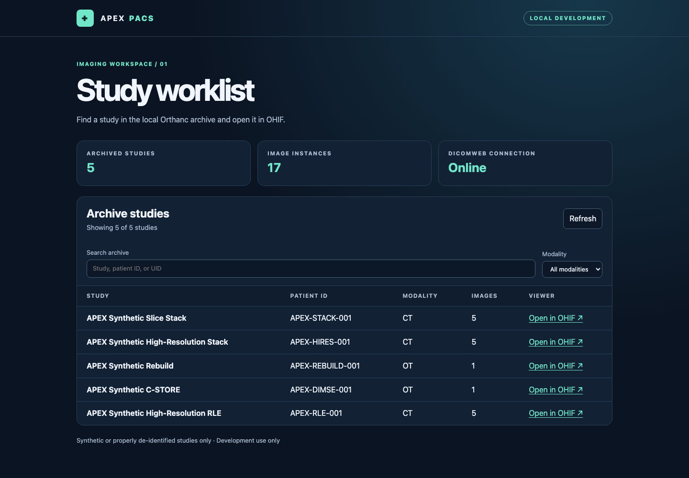
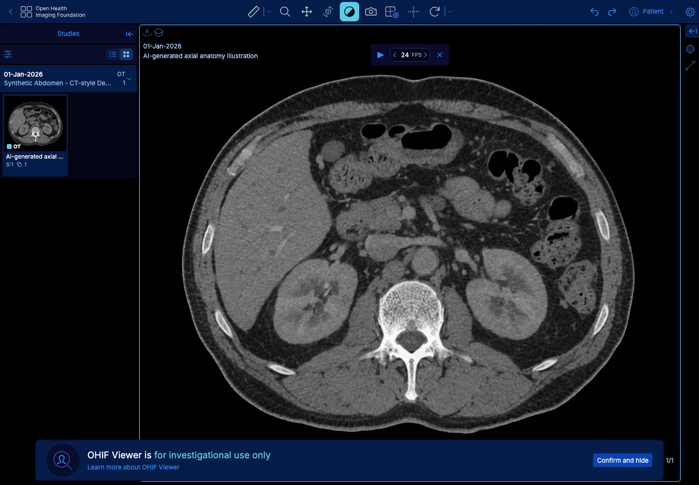
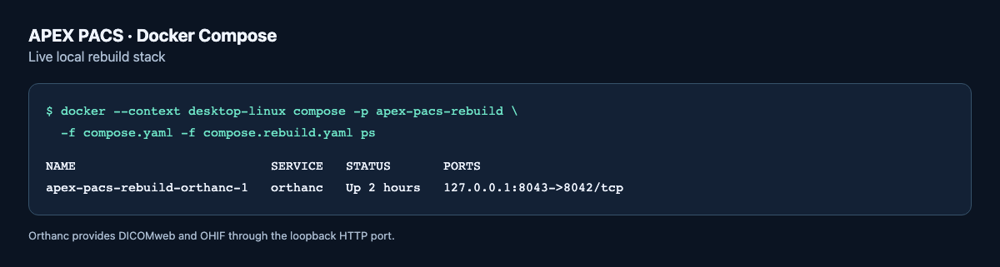

<div align="center">

# APEX PACS

### A DICOM modernization gateway for legacy imaging systems

A local medical imaging modernization prototype for Apple silicon macOS. APEX PACS connects legacy DICOM C-STORE ingestion to an Orthanc archive, DICOMweb retrieval, and OHIF rendering. The custom worklist provides search, modality filters, archive counts, and direct study links.

**[Download the project brochure (PDF)](https://github.com/VicScottNYC/apex-pacs/raw/main/docs/APEX-PACS-Brochure.pdf)**




<sub>Synthetic and de-identified DICOM only. Not for clinical use.</sub>

</div>

---

## Why it matters

When a healthcare organization still relies on imaging equipment or archives that exchange studies over traditional DICOM, adding browser-based access can be difficult. APEX PACS demonstrates an incremental upgrade path: a compatible system can keep sending studies via DICOM C-STORE while the gateway makes those same images searchable and viewable through DICOMweb and OHIF. That gives teams a way to test a modern viewing workflow before deciding which existing systems need to change.

## Highlights

| What | Result |
| --- | --- |
| Legacy ingestion | DICOM C-ECHO and C-STORE return status `0x0000`; stored UIDs and pixel bytes match on WADO-RS retrieval |
| DICOMweb | QIDO-RS finds the study, series and instances; WADO-RS returns every slice with matching geometry and pixel bytes |
| High-resolution retrieval | 2048 × 2048, 16-bit five-slice stack: 123.63 ms median total download on localhost |
| RLE Lossless | 98.4% smaller response than Explicit VR Little Endian for the synthetic pattern, with lossless decode |
| Viewing | OHIF renders the synthetic stacks and scrolls them in both directions |

## Screenshots

<table>
<tr>
<td width="50%"></td>
<td width="50%"></td>
</tr>
<tr>
<td><b>OHIF Viewer</b>: a synthetic axial abdomen illustration loaded through DICOMweb.</td>
<td><b>Docker Compose status</b>: the running rebuild stack and its loopback-only HTTP binding. Orthanc serves both DICOMweb and OHIF through port 8043.</td>
</tr>
</table>

Run from the project folder to check your own stack:

    docker --context desktop-linux compose -p apex-pacs-rebuild \
      -f compose.yaml -f compose.rebuild.yaml ps

Look for `Up` and `127.0.0.1:8043->8042/tcp`. The DICOM listener on
port 4242 is reachable by the test sender on the Docker network.

## Architecture

```text
Legacy modality / archive ──DICOM C-STORE (4242)──▶ Orthanc archive
                                                        │
                       ┌────────────────────────────────┤
                       ▼                                ▼
         DICOMweb (QIDO-RS / WADO-RS)            OHIF Viewer
                       │
                       ▼
          APEX worklist (Node.js, read-only, 127.0.0.1:8080)
```

| Path | What it is |
| --- | --- |
| `compose.yaml`, `compose.rebuild.yaml` | Orthanc with the DICOMweb and OHIF plugins; isolated rebuild stack on port 8043 |
| `worklist/` | Read-only study worklist: search, modality filters, archive counts, study links |
| `scripts/` | Synthetic DICOM generators and DICOMweb, DIMSE and local-binding checks |
| `fixtures/` | Source image for the synthetic anatomy demo |

## Quick start

### Open the worklist

Install Docker Desktop with Compose, Node.js 22 or later, and Python 3 for fixture generation. Start the isolated rebuild stack using the instructions below, then run:

```sh
node worklist/server.mjs
```

Open [the worklist](http://127.0.0.1:8080/). It reads the rebuild archive on port 8043 by default. To use the original development archive, run `APEX_ORTHANC_PORT=8042 node worklist/server.mjs`. Use Refresh after importing studies. An empty archive displays an empty state, and a stopped archive displays a connection error.

The worklist server binds to loopback and serves a read-only study list. OHIF loads directly from Orthanc. Stop the worklist with Control+C.

### Load the anatomy demo

With the rebuild stack running, create and import the included
CT-style axial abdomen example from the project folder:

    python3 -m venv samples/.rebuild-venv
    samples/.rebuild-venv/bin/python -m pip install 'pydicom==3.0.2' Pillow
    samples/.rebuild-venv/bin/python scripts/generate_anatomy_demo.py
    curl -fsS --data-binary @samples/apex-anatomy-demo.dcm http://127.0.0.1:8043/instances

Refresh the worklist and open **Synthetic Abdomen - Axial Demo**
(`APEX-ANATOMY-001`). The source is a synthetic anatomy illustration
wrapped as a single DICOM Secondary Capture, with no patient data or
calibrated Hounsfield units. The geometric fixtures below support the
repeatable pipeline and scrolling checks.

## Performance and interoperability

### High-resolution imaging baseline

Both synthetic studies used five uncompressed 16-bit slices and were
retrieved through WADO-RS on the isolated rebuild stack at
127.0.0.1:8043. The 2048 × 2048 fixture was generated by scaling the
128 × 128 synthetic slice stack and assigning new DICOM UIDs.

| Slice dimensions | WADO-RS response size | Median time to first byte | Median total download time |
| --- | ---: | ---: | ---: |
| 128 × 128 | 170,661 bytes | 2.00 ms | 3.34 ms |
| 2048 × 2048 | 41,950,011 bytes | 3.72 ms | 123.63 ms |

Each median is from three localhost requests. All six returned HTTP
200, and curl discarded each response body after transfer. These are
local retrieval measurements. Browser load time was not measured.

In OHIF Basic Viewer, APEX Synthetic High-Resolution Stack
(APEX-HIRES-001) rendered and scrolled through all five slices in
both directions. The generated DICOM files are local fixtures under
samples/apex-highres-stack/ and are excluded from Git.

### RLE Lossless interoperability

Five synthetic 2048 × 2048, 16-bit slices were encoded as DICOM RLE
Lossless. Each saved slice decoded to the original pixel bytes.

Direct WADO-RS requests verified the delivered syntax, instance UIDs,
and decoded pixel bytes for all five slices in both encodings.

| Requested transfer syntax | Multipart HTTP body size |
| --- | ---: |
| RLE Lossless (1.2.840.10008.1.2.5) | 683,950 bytes |
| Explicit VR Little Endian (1.2.840.10008.1.2.1) | 41,950,001 bytes |

RLE reduced the response size by 98.4% for this synthetic pattern.
OHIF displayed all five slices in order. The transfer syntax delivered
to OHIF for this RLE study remains unconfirmed.

## Scope

Project 4 runs locally on Apple silicon macOS with Docker Desktop.
Orthanc stores DICOM studies and serves DICOMweb and OHIF Viewer.
Use only synthetic or properly de-identified DICOM. Clinical use,
production deployment, real patient data, AI diagnosis, and paid
cloud services are outside this project's scope.

## Local development runbook

<details>
<summary><b>Start the archive</b></summary>

Open Docker Desktop and wait for the engine to start. From the folder
containing compose.yaml, run:

```sh
export PATH="$HOME/.docker/bin:$PATH"
docker --context desktop-linux compose config --quiet &&
  docker --context desktop-linux compose pull orthanc &&
  docker --context desktop-linux compose up -d --pull never orthanc
```

This uses the locally pulled ARM64 Orthanc image. Keep the HTTP port
bound to 127.0.0.1 because HTTP authentication is disabled.

</details>

<details>
<summary><b>Verify the archive</b></summary>

docker --context desktop-linux compose ps
    curl -fsS http://127.0.0.1:8042/studies
    curl -fsS -H 'Accept: application/dicom+json' \
      'http://127.0.0.1:8042/dicom-web/studies?PatientID=APEX-SYNTH-001'

Expect Orthanc to be Up on 127.0.0.1:8042 and the DICOMweb query to
return the synthetic study with one series and one instance.

If the archive is empty and the original synthetic sample is available,
import it from the project folder:

    curl -fsS --data-binary @samples/apex-synthetic-sc.dcm \
      http://127.0.0.1:8042/instances

Open http://127.0.0.1:8042/ohif/ and select APEX Synthetic Test Pattern,
then Basic Viewer. The image shows a bright circle over a grayscale
gradient. Sprint 1 also verified an exact QIDO-RS Study Instance UID
match and a WADO-RS HTTP 200 multipart DICOM response.

</details>

<details>
<summary><b>Stop and restart</b></summary>

docker --context desktop-linux compose stop orthanc

Run the start command to restart. The archive is stored in the
apex-pacs_orthanc-data named volume and survives stops and container
recreation. Running docker compose down -v deletes that volume.

</details>

<details>
<summary><b>Troubleshoot</b></summary>

docker --context desktop-linux compose config --quiet
    docker --context desktop-linux compose logs --tail=100 orthanc

In compose.yaml, keep environment under services.orthanc, declare each
environment key once, and declare orthanc-data under the top-level
volumes section. For a DICOMweb or OHIF 404 after a change, check the
startup logs for plugin registration and confirm the running container
received the new settings.

Keep samples/, its Python environment, and DICOM exports outside Git.

</details>

<details>
<summary><b>Verify the isolated five-slice rebuild</b></summary>

Run from the APEX PACS project folder. Start the rebuild stack on port
8043 using its separate archive volume:

    docker --context desktop-linux compose -p apex-pacs-rebuild \
      -f compose.yaml -f compose.rebuild.yaml up -d orthanc
    curl -fsS --retry 5 --retry-all-errors --max-time 5 \
      http://127.0.0.1:8043/studies

#### First run with an empty rebuild archive

Create the Python environment and install the fixture dependency:

    python3 -m venv samples/.rebuild-venv
    samples/.rebuild-venv/bin/python -m pip install 'pydicom==3.0.2'

On a fresh checkout, generate the fixtures:

    samples/.rebuild-venv/bin/python scripts/generate_synthetic_dicom.py
    samples/.rebuild-venv/bin/python scripts/generate_synthetic_stack.py

If the fixture files already exist, reuse them. The generators protect
existing output, and regenerating fixtures would create new DICOM UIDs.

Upload the five synthetic slices in reverse order:

    (
      set -e
      for slice_number in 05 04 03 02 01; do
        curl -fsS --data-binary "@samples/apex-synthetic-stack/slice-$slice_number.dcm" \
          http://127.0.0.1:8043/instances
        printf '\n'
      done
    )

#### Run the smoke test

If the rebuild archive already contains the five matching local slices,
start here:

    samples/.rebuild-venv/bin/python scripts/check_dicomweb.py

Expect two PASS lines. QIDO-RS finds one study with one series and five
instances. WADO-RS returns all five slices with matching geometry and
pixel bytes.

Open http://127.0.0.1:8043/ohif/, select APEX Synthetic Slice Stack, and
open Basic Viewer. Scroll through all five slices and back. The circle
should grow steadily in one direction and shrink in the other.

</details>

<details>
<summary><b>Verify local DIMSE ingestion</b></summary>

Start the isolated rebuild stack. If samples/apex-rebuild-sc.dcm is
missing, generate it using the rebuild instructions above. From the
APEX PACS project folder, run:

    "$HOME/.docker/bin/docker" --context desktop-linux run --rm \
      --platform linux/arm64 \
      --network apex-pacs-rebuild_default \
      --mount "type=bind,source=$PWD/scripts/check_dimse.py,target=/check_dimse.py,readonly" \
      --mount "type=bind,source=$PWD/samples/apex-rebuild-sc.dcm,target=/fixture.dcm,readonly" \
      python:3.12-slim \
      sh -c 'python -m pip install --quiet "pydicom==3.0.2" "pynetdicom==3.0.4" &&
        python /check_dimse.py echo &&
        python /check_dimse.py store'

Expect C-ECHO and C-STORE status 0x0000, followed by a WADO-RS match
for the study, series, and instance UIDs and pixel bytes. Reruns with
the same fixture reuse the same UIDs. Port 4242 stays inside the
Docker network.

In OHIF at http://127.0.0.1:8043/ohif/, open APEX Synthetic C-STORE
(APEX-DIMSE-001) in Basic Viewer. Expect a bright circle over a
grayscale gradient.

</details>

---

<div align="center">

Built by **Victor Scott** · [github.com/VicScottNYC](https://github.com/VicScottNYC)

</div>
